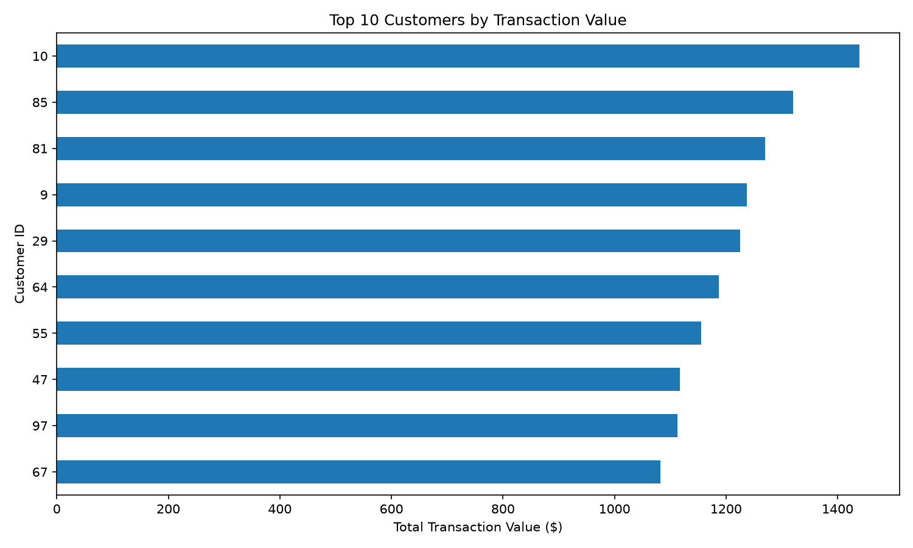

# Finance Transaction ETL Pipeline 

## Overview 
A Python ETL pipeline that reads financial transactions from CSV files, validates records, and exports cleaned and rejected transactions separately 

## Features 
- CSV ingestion 
- Transaction validation 
- Duplicate detection 
- Rejection, with reason tracking 
- CSV export 
- logging and error handling
- Testing with pytest 

## PostgreSQL & SQL Analysis

This project includes a PostgreSQL database containing 1,000 synthetically generated financial transactions.

SQL queries were developed to analyze customer transaction activity and identify patterns in transaction value.


## Business questions explored:
1. Which customers generate the highest total transaction value?
2. Which customers have above-average total transaction values?
3. How do customers rank by transaction value?

SQL scripts are available in `sql/schema.sql` and `sql/analysis.sql`.

Note: All analytical data is synthetic.
View the [SQL analysis queries](sql/analysis.sql).

## Data Visualizations
- Top 10 Customers by Transaction Value
- Transaction Amount Distribution
- Top 10 Customers by Transaction Frequency

## Project Structure
### Application Modules  
- ingestion.py: reads transaction data from CSV files normalizes values into appropriate Python data types.
- cleaning.py: validates transaction records and identifies invalid records (missing customer ids, missing transaction ids, duplicate transaction ids, invalid amounts).
- export.py: Writes valid and invalid transactions into separate CSV files. 

### Data files 
- transactions.csv: simulated input transaction data
- clean_transactions.csv: output file containing valid transactions.  
- rejected_transactions.csv: output file containing invalid transactions.  


### Tests
Contains: 
- test_cleaning.py: tests transaction validation
- test_ingestion.py: tests CSV ingestion and data conversion 
- test_export.py: tests CSV export functionality 
- test_pipeline.py: tests complete pipeline

### main.py
- main.py: Coordinates ingestion, cleaning, logging, and CSV exports through the run_pipeline() function.

## Financial Transaction Analysis

### Overview
This project extends a Python-based ETL pipeline with exploratory data analysis and visualizations using a reproducible synthetic dataset of 1,000 financial transactions across 100 customers.

### Summary Statistics
| Metric | Value |
|---|---:|
| Total Transactions | 1,000 |
| Unique Customers | 100 |
| Total Transaction Value | $68,929.62 |
| Average Transaction Amount | $68.93 |
| Median Transaction Amount | $54.73 |
| Largest Transaction | $505.32 |

### Key Findings
**1. Transaction Amount Distribution**
The average transaction amount ($68.93) exceeds the median ($54.73), suggesting a right-skewed distribution in which larger transactions increase the mean.

**2. High-Value Transactions**
The largest transaction ($505.32) is approximately 9.2 times the median, highlighting substantial variation in transaction amounts.

**3. Customer Activity**
The dataset contains 1,000 transactions across 100 unique customers, averaging 10 transactions per customer. Customer-level aggregations allow further examination of transaction frequency and value concentration.

### Visualizations
The analysis includes three visualizations:

- Top 10 customers by total transaction value
- Distribution of transaction amounts
- Top 10 customers by transaction frequency

### Data Limitations
All transactions are synthetically generated for educational and portfolio purposes. The findings demonstrate analytical methods and do not represent real financial activity.


### Top 10 Customers by Transaction Value



### Transaction Amount Distribution


### Customer Transaction Frequency


## How to Run 
Clone or download the repository and navigate to the project directory.

Run the pipeline:
```bash
python main.py
```

The pipeline reads data/transactions.csv and generates two output files:
- data/clean_transactions.csv
- data/rejected_transactions.csv

## Testing 
Install pytest if necessary:
```bash
python -m pip install -r requirements.txt
```
Run all automated tests:
```bash
python -m pytest -v
```
The test suite covers ingestion, validation, CSV exports, and end-to-end pipeline functionality.
