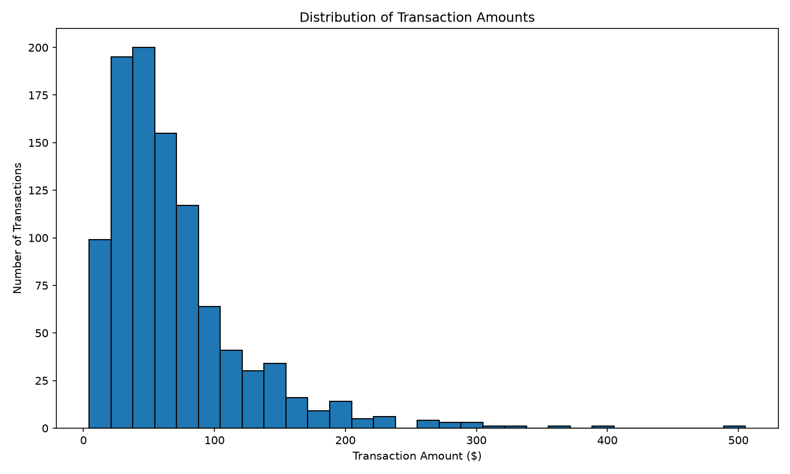
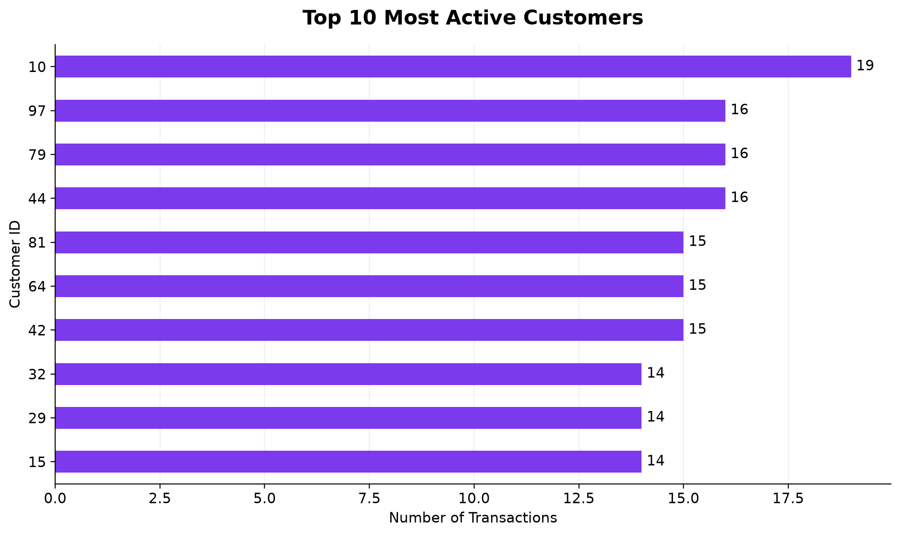
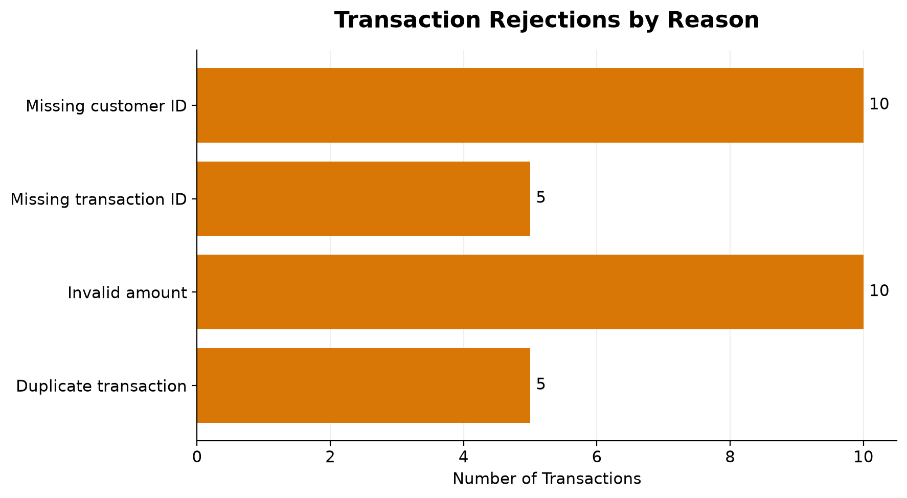
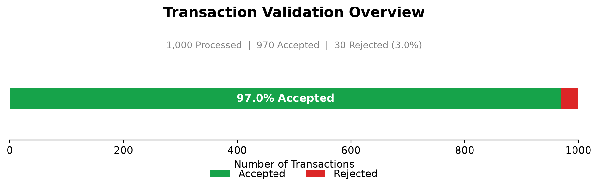

# Finance Transaction ETL Pipeline 


## Overview 
A Python ETL pipeline that reads financial transactions from CSV files, validates records, and exports cleaned and rejected transactions separately 

## Features 
- CSV ingestion 
- Transaction validation 
- Duplicate detection 
- Rejection, with reason tracking 
- CSV export 
- logging and error handling
- synthetic data generation 
- PosgreSQL and SQL analysis
- Data visualization 
- Testing with pytest 

## Data Quality Validation
The project uses a synthetic dataset of 1,000 financial transactions. A separate script intentionally introduces invalid records to test the pipeline's validation and rejection logic.

### Validation Results
Total transactions: 1,000
Valid transactions: 970
Rejected transactions: 30
Acceptance rate: 97%

### Rejection Breakdown
Missing customer ID: 10
Invalid amount: 10
Missing transaction ID: 5
Duplicate transaction ID: 5

Rejected transactions are exported separately with a rejection_reason column, allowing invalid records to be inspected without affecting the clean dataset.

## PostgreSQL & SQL Analysis
This project includes PostgreSQL schema definitions and SQL queries for analyzing synthetic financial transaction data. 

SQL queries were developed to analyze customer transaction activity and identify patterns in transaction value.


## Business questions explored:
1. Which customers generate the highest total transaction value?
2. Which customers have above-average total transaction values?
3. How do customers rank by transaction value?

SQL scripts are available in `sql/schema.sql` and `sql/analysis.sql`.

Note: All analytical data is synthetic.
View the [SQL analysis queries](sql/analysis.sql).

## Data Visualizations
- Top 10 Customers by Transaction Value

- Transaction Amount Distribution

- Top 10 Customers by Transaction Frequency

- Transaction rejections by reason 

- Transaction validation results


## Project Structure
### Application Modules  
- ingestion.py: reads transaction data from CSV files normalizes values into appropriate Python data types.
- cleaning.py: validates transaction records and identifies invalid records (missing customer ids, missing transaction ids, duplicate transaction ids, invalid amounts).
- export.py: Writes valid and invalid transactions into separate CSV files. 

### Data Files
- `data/transactions.csv`: Small sample dataset used by the original ETL pipeline.
- `data/clean_transactions.csv`: Valid transactions exported by the original pipeline.
- `data/rejected_transactions.csv`: Invalid transactions exported with rejection reasons.
- `data/analytics_transactions.csv`: Original synthetic dataset containing 1,000 valid transactions.
- `data/analytics_transactions_dirty.csv`: Dataset containing 1,000 transactions, including 30 intentionally invalid records.
- `data/analytics_clean.csv`: Output containing 970 validated transactions.
- `data/analytics_rejected.csv`: Output containing 30 rejected transactions with their rejection reasons.

### Tests
Contains: 
- test_cleaning.py: tests transaction validation
- test_ingestion.py: tests CSV ingestion and data conversion 
- test_export.py: tests CSV export functionality 
- test_pipeline.py: tests complete pipeline

### main.py
- main.py: Coordinates ingestion, cleaning, logging, and CSV exports through the run_pipeline() function. Supports configurable input and output paths through command-line arguments using Python's argparse library.

# How to Run
Clone the repository and navigate to the project directory.

1. Install Dependencies
```bash
python -m pip install -r requirements.txt
```
2. Run the Original ETL Pipeline
```bash 
python main.py
```
This processes data/transactions.csv and generates:
data/clean_transactions.csv
data/rejected_transactions.csv

3. Generate the Dirty Dataset
```bash
python -m analytics.generate_dirty_data
```
This introduces controlled validation errors into the synthetic analytics dataset.

4. Run pipeline on Analytics Dataset 
```bash 
python main.py \
  --input data/analytics_transactions_dirty.csv \
  --valid data/analytics_clean.csv \
  --rejected data/analytics_rejected.csv
```
Expected results: 970 valid transactions and 30 rejected transactions.

5. Generate the Dashboard
```bash
python -m analytics.visualize
```
The generated visualizations are saved in the dashboard/ directory.

## Testing
Run all automated tests:
```bash
python -m pytest -v
```
The test suite covers ingestion, validation, CSV exports, and end-to-end pipeline functionality.
